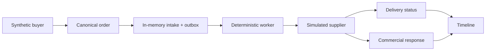

# Nodus Integration Lab

A standalone, synthetic-data architecture demonstration for B2B order integration. It explores accepting an order once, normalizing partner-specific formats, processing delivery asynchronously, and keeping technical delivery separate from the commercial response.

**Status:** experimental portfolio lab. This is a new, self-contained demonstration derived from the project's general architectural ideas, not the original private application or a customer deployment. It does not include production code, customer records, real partner endpoints, credentials or deployment infrastructure.

## Architecture



The runnable Go example uses standard-library-only code and synthetic fixtures; no database, broker, network or account is required. The in-memory outbox illustrates ordering and retry semantics, **not** transactional durability.

## Quick start

Install Go 1.22 or later.

```sh
go test ./...
go run ./cmd/demo
```

The demo submits the same order twice, processes a simulated transient failure, delivers it on retry and records a distinct commercial acceptance. Output is a synthetic event timeline.

## Engineering decisions

- A canonical input contract limits partner-specific mapping to a boundary.
- Idempotency keys distinguish identical retries from conflicting submissions.
- An outbox separates intake from delivery in the example; durable implementations require a transactional store.
- Technical delivery and commercial acceptance are independent, explicit states.
- Retries are bounded; failures are visible rather than silent.

See [architecture decisions](docs/DECISIONS.md) for rationale and limitations.

## What this does not establish

No production deployment, live customer outcomes, security certification, throughput benchmark or exact-once execution is claimed. The simulated supplier does not call an external service. Nothing in this demo is intended for real orders. See [scope and limitations](docs/DECISIONS.md).

## Rights and attribution

The lab is public to demonstrate architectural concepts. No open-source license is granted here. Public visibility does not grant permission to redistribute or reuse its source beyond applicable law and GitHub's terms. Any future license must be chosen by the repository owner. This demo uses only Go's standard library; no third-party source or assets are included.
